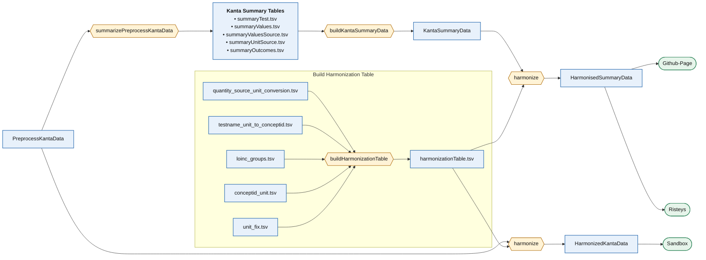

# Kanta Lab Harmonisation Structure

The aim is to build one harmonization table and apply it to both the Preprocess Kanta Data and the Kanta summary data, so the harmonization logic lives in a single place. The harmonization script is deliberately simple: it only joins the harmonization table to either the Preprocess Kanta Data or the Kanta summary data (it runs once on each, hence the two boxes below). The harmonization table is built by combining 5 different tables into one, so everything is already resolved in it and the script has nothing left to decide. The Preprocess Kanta Data is the Kanta data after the preprocessing steps, ending with the Primary Injection step. The Kanta summary data is a count of the distinct rows: `summarizePreprocessKantaData` produces 5 summary tables, which are later combined, outside the sandbox, into one Kanta summary data. The harmonized Kanta data goes to the sandbox, and the harmonized summary data goes to the Github-Page and to Risteys.

---

## Preprocess Kanta Data

`PreprocessKantaData`: the lab measurement records after preprocessing, one row per record. It comes after the Primary Injection step (clean and rename columns, free-text extraction, regex cleanup, unit validation, then Primary Injection, a statistical guess of missing units), so it is the output of that step. Only the columns the pipeline needs are described here.

| Column | Type | Description |
|---|---|---|
| FINNGENID | Character | Subject identifier |
| SEX | Character | Subject sex |
| DATE | Date | Date of the measurement |
| **TEST_NAME** | Character | Lab test name |
| **MEASUREMENT_UNIT** | Character | Lab test unit |
| **VALUE** | Numeric | Measurement value |
| ... | | Other columns |

---

## Kanta summary tables

`summarizePreprocessKantaData` turns the Preprocess Kanta Data into 5 summary tables, written to `DATA_SUMMARY/0_KantaSummaryTables/`. Each is keyed by the `TEST_NAME` + `MEASUREMENT_UNIT` pair. Subject counts of 5 or fewer are removed.

**summaryTest** — one row per pair.

* `TEST_NAME`: Character, lab test name
* `MEASUREMENT_UNIT`: Character, lab test unit
* `n_records`: Integer, number of records for the pair
* `n_subjects`: Integer, number of patients for the pair (removed if <=5)

**summaryValuesSource** — source distribution of the value for each pair.

* `TEST_NAME`: Character, lab test name
* `MEASUREMENT_UNIT`: Character, lab test unit
* `value_source`: label for the type of value source (`Source`, `Extracted`, `QCOut`)
* `n_subjects`: Integer, number of subjects (removed if <=5)
* `n_records`: Integer, number of records

**summaryUnitSource** — source distribution of the unit for each pair.

* `TEST_NAME`: Character, lab test name
* `MEASUREMENT_UNIT`: Character, lab test unit
* `unit_source`: label for the type of unit source
* `n_subjects`: Integer, number of subjects (removed if <=5)
* `n_records`: Integer, number of records

**summaryValues** — value distribution for each pair.

* `TEST_NAME`: Character, lab test name
* `MEASUREMENT_UNIT`: Character, lab test unit
* `n_subjects`: Integer, number of subjects (removed if <=5)
* `n_records`: Integer, number of records
* `decile`: Numeric, decile (0.1 to 0.9)
* `decile_MEASUREMENT_VALUE`: Numeric, value at that decile

**summaryOutcomes** — outcome distribution for each pair.

* `TEST_NAME`: Character, lab test name
* `MEASUREMENT_UNIT`: Character, lab test unit
* `TEST_OUTCOME`: Character, test outcome
* `n_TEST_OUTCOME`: Integer, number of test outcomes
* `n_subjects`: Integer, number of subjects (removed if <=5)

---

## Kanta summary data

`KantaSummaryData`: the 5 summary tables combined by `buildKantaSummaryData` into one table, one row per `TEST_NAME` + `UNIT` pair and decile. It is the long form of `DATA_SUMMARY/1_BuildKantaSummaryData/kantaSummaryData.tsv`: instead of packing all the deciles into one `value_deciles` string, each decile gets its own row.

* `TEST_NAME`: Character, lab test name
* `UNIT`: Character, lab test unit (empty when no unit is recorded)
* `n`: Integer, number of records for the pair (repeated on every decile row)
* `unit_source_injection_correction_na_p`: Character, `[source%,injection%,correction%,na%]`, the percent of the pair's records whose unit comes from the `Source`, `PrimaryInjection`, `SecondaryCorrection`, or is missing
* `value_missing_p`: Numeric, percent of the pair's records with no value
* `value_source_extracted_qcout_na_p`: Character, `[source%,extracted%,qcout%,na%]`, the percent of the pair's records whose value is `Source`, `Extracted`, `QCOut`, or missing
* `decile`: Numeric, which decile the row holds (0.1 to 0.9)
* `decile_value`: Numeric, the measurement value at that decile. Empty for pairs with no deciles (low volume or no values)

---

## Harmonization table

`harmonizationTable.tsv`: built by `buildHarmonizationTable` from the 5 tables in the box above. One row per source `TEST_NAME` + `UNIT` pair, resolved all the way to its OMOP concept, target unit and conversion, so the harmonize scripts only have to join it. The columns below are the proposed design.

| Column | Description | Comes from |
|---|---|---|
| `TEST_NAME` | Source lab test name (join key) | `testname_unit_to_conceptid.tsv` |
| `UNIT` | Source unit (join key). Empty for qualitative tests | `testname_unit_to_conceptid.tsv` |
| `UNIT_FIXED` | Source unit after correcting known unit errors | `unit_fix.tsv` |
| `OMOP_ID` | Target OMOP measurement `concept_id` | `testname_unit_to_conceptid.tsv` |
| `OMOP_NAME` | OMOP `concept_name` for `OMOP_ID` | `testname_unit_to_conceptid.tsv` |
| `OMOP_QUANTITY` | OMOP quantity, e.g. `Mass Concentration` | `testname_unit_to_conceptid.tsv` |
| `LOINC_GROUP` | LOINC group the concept belongs to | `loinc_groups.tsv` |
| `TO_UNIT` | Unit the value is converted to, the preferred unit for the concept | `conceptid_unit.tsv` |
| `CONVERSION` | Factor so that `value_in_TO_UNIT = value_in_UNIT * CONVERSION` | `quantity_source_unit_conversion.tsv` |

How the 5 tables combine:

1. `testname_unit_to_conceptid.tsv` is the base: it gives each `TEST_NAME` + `UNIT` pair its `OMOP_ID`, name and quantity.
2. `unit_fix.tsv` is applied to `UNIT` first, so a misspelled or mislabeled unit resolves to the right one.
3. `loinc_groups.tsv` is joined on `OMOP_ID` to add the LOINC group.
4. `conceptid_unit.tsv` is joined on `OMOP_ID` to add the target unit.
5. `quantity_source_unit_conversion.tsv` is joined on `OMOP_QUANTITY` + `UNIT_FIXED` + `TO_UNIT` to add the conversion factor.

---

## Harmonized Kanta data

`HarmonizedKantaData`, produced by `harmonize` and sent to the sandbox. It is `PreprocessKantaData` left-joined to `harmonizationTable.tsv` on `TEST_NAME` + `UNIT`.

* All columns of `PreprocessKantaData`.
* All columns of the harmonization table (`UNIT_FIXED`, `OMOP_ID`, `OMOP_NAME`, `OMOP_QUANTITY`, `LOINC_GROUP`, `TO_UNIT`, `CONVERSION`).
* `VALUE_HARMONIZED`: the raw value times `CONVERSION`, in `TO_UNIT`.

---

## Harmonized summary data

`HarmonisedSummaryData`, produced by `harmonize` and sent to the Github-Page and to Risteys. It is `KantaSummaryData` left-joined to `harmonizationTable.tsv` on `TEST_NAME` + `UNIT`.

* All columns of `KantaSummaryData`.
* All columns of the harmonization table (`UNIT_FIXED`, `OMOP_ID`, `OMOP_NAME`, `OMOP_QUANTITY`, `LOINC_GROUP`, `TO_UNIT`, `CONVERSION`).
* `decile_value_harmonized`: `decile_value` times `CONVERSION`, in `TO_UNIT`.
