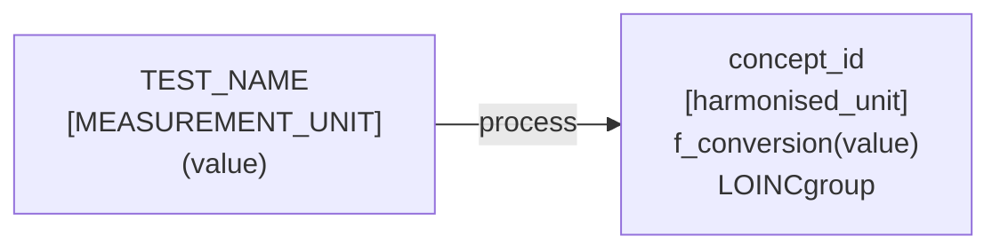
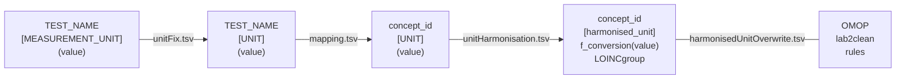

# Kanta lab harmonisation

# Overview

## Problem

Each `TEST_NAME [MEASUREMENT_UNIT]` pair of the Kanta lab data has to be mapped to an existing
`concept_id [harmonised_unit]` of the OMOP vocabulary, such that:

- the `TEST_NAME` has the same meaning as the `concept_name` (the same LOINC axes: component, property,
  system, ...);
- the `UNIT` is compatible with the `harmonised_unit`, so the values can be converted;
- the Kanta values, once converted, are in the same distribution as the other values of the
  `concept_id [harmonised_unit]` (and of its LOINC Group).

## Process

`TEST_NAME` is mapped to `concept_id` with `mapping.tsv`, and the `UNIT` is converted to the
`harmonised_unit`, when they differ, with `unitHarmonisation.tsv`:

However, the `MEASUREMENT_UNIT` on the left may be wrong, and so may the `harmonised_unit` on the right.
`unitFix.tsv` fixes the first and `harmonisedUnitOverwrite.tsv` the second. The target (`3_Target`) is built only
from the source data (OMOP, lab2clean) and never edited: every fix by hand is a table of `2_Harmonisation`,
applied in `4_BuildHarmonisationTable`.

## Errors along the process

### Input errors (stop the pipeline)

Each block validates its input tables first and stops when a test is an ERROR, so nothing downstream runs on
broken input. The report says which test failed, with examples:

| Input | Report | Stops |
|---|---|---|
| `1_Input` (Kanta summaries, `DATA/settings.yaml`) | `DATA/1_Input/1_BuildKantaAgregatedTable/kantaAgregatedTable.validation.md` | `1_BuildKantaAgregatedTable` |
| `3_Target` (OMOP, lab2clean, LOINC Groups) | `DATA/3_Target/4_BuildTargetTable/targetTable.validation.md` | `4_BuildTargetTable` |
| `2_Harmonisation` (each hand-edited table on its own) | `DATA/4_BuildHarmonisationTable/harmonisationTable.validation.md` | `4_BuildHarmonisationTable` |

Solution: fix the table the failing test names (for `1_Input`, report it upstream to whoever builds the Kanta
summaries) and rerun. The WARNINGs of these reports do not stop the step (e.g. a row of `mapping.tsv` or
`unitFix.tsv` that no Kanta pair uses); review them when convenient.

### Errors of the mappings

An `APPROVED` mapping with an error gets `mapping_status` `ERROR:<reason>` in
`DATA/4_BuildHarmonisationTable/harmonisationTable.tsv`, and the dashboard lists the errors by reason. The
reason is the first that applies, in this order: `MissingConceptId`, `PropertyUnitMismatch`,
`SharedProperty`, `MissingConversion`, `LoincGroupUnitsMissmatch`. A warning marked `ignore` in its warning table is not
an error.

### Mapping

- **Mapping missing**
  - Label: `mapping_status` = `MISSING`.
  - Description: nobody has mapped this Kanta test yet, so it is not linked to any OMOP concept.
  - Source: the `TEST_NAME [MEASUREMENT_UNIT]` of `kantaAgregatedTable.tsv` is not in `mapping.tsv` (as
    `TEST_NAME [UNIT]`), nor fixed by `unitFix.tsv` to a `TEST_NAME [UNIT]` of `mapping.tsv`.
  - Solution: add a row to `mapping.tsv` for it. If `unitFix.tsv` already fixes it (a WARNING "TEST_NAME + UNIT
    is used downstream" in `harmonisationTable.validation.md`), add the row for the fixed `UNIT`.
- **Mapping not approved**
  - Label: `mapping_status` = `NOT-APPROVED`.
  - Description: the test has a suggested concept, but nobody has confirmed it is right.
  - Source: `mapping.tsv` has the `TEST_NAME [UNIT]` with `APPROVED` = `FALSE`.
  - Solution: none needed; review it and set `APPROVED` to `TRUE` when it is right.
- **Mapping ignored**
  - Label: `mapping_status` = `IGNORE`.
  - Description: the test was looked at and left out on purpose, because no OMOP concept fits it.
  - Source: `mapping.tsv` has the `TEST_NAME [UNIT]` with a value in `ignore_mapping_reason`.
  - Solution: none needed.
- **Concept not in the target**
  - Label: `mapping_status` = `ERROR:MissingConceptId`.
  - Description: the test is mapped to a concept that is not a target: not a standard `Measurement` concept
    (e.g. an old concept after an update of the OMOP vocabulary), or not in the vocabulary at all.
  - Source: the `concept_id` of the `TEST_NAME [UNIT]` in `mapping.tsv` is not in `targetTable.tsv`
  - Solution: map it to the right standard concept in `mapping.tsv`, or give it an `ignore_mapping_reason`.
- **Shared property**
  - Label: `mapping_status` = `ERROR:SharedProperty`.
  - Description: one test, reported in different units, is mapped to different concepts that measure the
    same kind of quantity, e.g. Albumin mass concentration in Urine and in Serum. Usually only one of them
    is right.
  - Source: in `mapping.tsv`, `TEST_NAME [UNIT_1]` maps to `concept_id_1` and `TEST_NAME [UNIT_2]` to
    `concept_id_2`, both with the same `has_property` in `targetTable.tsv`; a row in
    `DATA/4_BuildHarmonisationTable/testname_property_shared_warning.tsv` with `ignore` = `FALSE`.
  - Solution 1: one or more of the mappings is wrong; fix it in `mapping.tsv`.
  - Solution 2: one or more of the units is wrong; fix it in `unitFix.tsv`.
  - Solution 3: it is right; set `ignore` to `TRUE` in `testname_property_shared_warning.tsv`.

### Unit

- **Missing conversion**
  - Label: `mapping_status` = `ERROR:MissingConversion`.
  - Description: the test has a unit, but its values cannot be converted: we do not know how to convert it to
    the unit of the concept, or the (quantitative) concept has no target unit at all. A test with no unit is
    not converted, so it is no error.
  - Source: a row in `DATA/4_BuildHarmonisationTable/test_unit_context_unit_missing_warning.tsv` with `ignore` =
    `FALSE`: the pair has a `UNIT`, and either `unitHarmonisation.tsv` has no row for `has_property` (or
    `concept_id`) + `UNIT` + target unit, or the concept has no `target_unit` (not qualitative or a panel, not in
    lab2clean and no row in `harmonisedUnitOverwrite.tsv`).
  - Solution 1: add a row with the conversion to `unitHarmonisation.tsv` (for the property, or for the
    concept when it only holds for it).
  - Solution 2: the concept has no target unit; add a row to `harmonisedUnitOverwrite.tsv` (and the conversion).
  - Solution 3: the `UNIT` is wrong; fix it in `unitFix.tsv`.
  - Solution 4: it is known and accepted; set `ignore` to `TRUE` in `test_unit_context_unit_missing_warning.tsv`.
- **Property and unit mismatch**
  - Label: `mapping_status` = `ERROR:PropertyUnitMismatch`.
  - Description: the unit of the test does not fit what the concept measures, e.g. a percentage for a
    concept that counts cells per litre.
  - Source: `unitHarmonisation.tsv` has no row with `context` = the `has_property` (or the `concept_id`) of
    the concept and the `UNIT` of the pair; a row in
    `DATA/4_BuildHarmonisationTable/testname_unit_property_missmatch_warning.tsv` with `ignore` = `FALSE`.
  - Solution 1: the mapping is wrong; fix it in `mapping.tsv`.
  - Solution 2: the `UNIT` is wrong; fix it in `unitFix.tsv`.
  - Solution 3: the unit is right for the property but has no rule; add it to `unitHarmonisation.tsv`.
  - Solution 4: it is known and accepted; set `ignore` to `TRUE` in `testname_unit_property_missmatch_warning.tsv`.

### LOINC Group

- **Mixed units in a Group**
  - Label: `mapping_status` = `ERROR:LoincGroupUnitsMissmatch`; also a WARNING in
    `DATA/3_Target/4_BuildTargetTable/targetTable.validation.md`.
  - Description: tests mapped to concepts of the same LOINC Group end up in different units, so their values
    cannot be compared with each other. Often the Group holds different quantities, e.g. a 24 h urine
    panel with a volume (`mL`), a duration (`h`) and concentrations. (The `UrineAndSed` Groups, which mix
    cells counted per field and per litre, are dropped in `3_GetLoincGroupsData`.)
  - Source: in `harmonisationTable.tsv`, the `APPROVED` pairs (not ignored) of one `group_concept_id` have
    more than one target unit (`target_unit`); every approved
    pair in such a Group that has a target unit gets a row in
    `DATA/4_BuildHarmonisationTable/test_unit_loinc_group_unit_mismatch_warning.tsv`, an error while its `ignore` is
    `FALSE` (a qualitative pair, with no target unit, does not). In `targetTable.validation.md` the same check runs on all the concepts of a
    Group: ERROR when `group_source` = `lab2clean`, WARNING when `LOINC`.
  - Solution 1: they are the same quantity in different units; pick one unit in
    `harmonisedUnitOverwrite.tsv`.
  - Solution 2: one of the mappings is wrong (another quantity than the test); fix it in `mapping.tsv`.
  - Solution 3: the Group mixes quantities on purpose; set `ignore` to `TRUE` in
    `test_unit_loinc_group_unit_mismatch_warning.tsv`.

### Value

- **Values mismatch**
  - Label: `KS` over 0.8 (disagree) or 0.5 to 0.8 (warning) in the dashboard (the thresholds are in
    `DATA/settings.yaml`); `log10_D5` gives the shift; a row in
    `DATA/5_EvaluateHarmonisedData/ks_test_warning.tsv`, counted in the Warnings(total) of the dashboard.
  - Description: after the conversion, the values of an approved test do not look like the values of the
    other approved tests of the same concept or Group.
  - Source: in `evaluatedHarmonisedKantaAgregatedTable.tsv`, `KS` between `decile_value_harmonised` of the
    `APPROVED` pair and `reference_decile_value_harmonised` (the median deciles of the other `APPROVED` pairs of its
    LOINC Group, or concept, with the same `HARMONISED_UNIT`).
  - Solution 1: the values are off by a factor (`log10_D5` near a whole number): the `UNIT` is wrong
    (`unitFix.tsv`) or the `CONVERSION` is wrong (`unitHarmonisation.tsv`).
  - Solution 2: the units convert but the test is another one (e.g. another specimen): fix the mapping in
    `mapping.tsv`.
  - Solution 3: no pair agrees with the others, or the labs report another unit: the `harmonised_unit` is
    wrong (`harmonisedUnitOverwrite.tsv`).
  - Solution 4: the difference is real and was reviewed (e.g. another population); set `ignore` to `TRUE` in
    `ks_test_warning.tsv`.

The `harmonisation_values_status` column of `DATA/5_EvaluateHarmonisedData/evaluatedHarmonisedKantaAgregatedTable.tsv`,
and the Harmonised Values table of the dashboard, put each pair in the first row that applies: AGREE, WARNING,
DISAGREE, then the rows below. Only `APPROVED` pairs are compared. (A pair with no values is counted under
**No value: fewer than 1000 values or 60 subjects** whatever its status.)

- **Error: values with missing units** ("Error" in red)
  - Label: the "Error: values with missing units" row of the dashboard.
  - Description: the test has values but was reported with no unit, so they cannot be converted.
  - Source: an `APPROVED` pair with no `UNIT` (and a concept that is not qualitative or a panel).
  - Solution: add a row to `unitFix.tsv` giving it the unit its values show.
### Informative only

These rows of the dashboard are not errors. They count the pairs whose values are not compared, and
nothing needs to be done about them here (an unmapped test is handled by the **Mapping** entries above).

| Row of the dashboard (grey) | Pairs it holds |
|---|---|
| Not compared: only one pair per group | approved pairs with fewer than 2 other approved pairs with harmonised deciles and the same `HARMONISED_UNIT` in any LOINC Group of their concept, or in the concept itself when it is in no Group |
| No value: value ignored, is qualitative or panel | approved pairs whose concept has `harmonised_unit_source` `isQualitative` or `panel` (no unit, so never compared; `no unit` in grey in the KS column) |
| No value: fewer than 1000 values or 60 subjects | pairs with fewer non-missing values (`n` × (1 − `value_missing_p` / 100)) than `n_records_no_value_threshold`, or fewer subjects than `n_subjects_no_value_threshold`, of `DATA/settings.yaml`, whatever their status. A pair above both always has its deciles: `1_BuildKantaAgregatedTable` stops otherwise (report it upstream) |
| Not mapped (NOT-APPROVED, IGNORE, MISSING or ERROR) | pairs whose `mapping_status` is not `APPROVED`: only approved mappings are compared |

- Solution: none; this is only informative.

## Rerunning after an edit

Rerun the step that reads the edited file and every step after it:

| Edited | Rerun from |
|---|---|
| `DATA/1_Input/0_KantaAgregatedData/` (new summaries) or the `1_Input` section of `DATA/settings.yaml` | `1_Input/1_BuildKantaAgregatedTable`, then `4_BuildHarmonisationTable`, 5 and 6 |
| a table of `2_Harmonisation`, or an `ignore` flag of a `_warning.tsv` of step 4 | `4_BuildHarmonisationTable`, then 5 and 6 |
| the `5_EvaluateHarmonisedData` section of `DATA/settings.yaml`, or an `ignore` flag of `ks_test_warning.tsv` | `5_EvaluateHarmonisedData`, then 6 |
| a new OMOP vocabulary or lab2clean version | the steps of `3_Target` in order, then 4, 5 and 6 |

# Repo

The repository is split in `SCRIPTS/` (the code, one folder per step, each with a README) and
`DATA/` (the result of each step, in a folder of the same name). The thresholds used across steps are in `DATA/settings.yaml`, one section per block or step. Every step runs as
`./SCRIPTS/<step>/run.sh <PATH_TO_DATA> --env <ENV_NAME>`, where `<step>` includes its block for the steps
of `1_Input` and `3_Target` (e.g. `3_Target/4_BuildTargetTable`). `1_Input/0_KantaAgregatedData`,
and `2_Harmonisation` are data and hand-edited tables, with no `run.sh`.

## 1_Input

The source values to map: one row per `TEST_NAME [MEASUREMENT_UNIT]` pair of Kanta, with the number of
records, where the unit and the value came from, the reference ranges and the deciles of the values.

## 2_Harmonisation

Hand-edited tables, the only place where the mapping is decided (besides the `ignore` flags of the four warning
tables of `4_BuildHarmonisationTable`):

- `unitFix.tsv` — the `MEASUREMENT_UNIT` may be wrong or missing; this table gives the corrected `UNIT`
  of a `TEST_NAME [MEASUREMENT_UNIT]` pair.
- `mapping.tsv` — maps each `TEST_NAME [UNIT]` to a `concept_id`, with `APPROVED` and, for a pair that is
  not mapped on purpose, an `ignore_mapping_reason`.
- `unitHarmonisation.tsv` — how a `UNIT` converts to the `harmonised_unit` (`CONVERSION`, a factor or a
  formula in `X`). A rule holds for a LOINC property (`context` = `has_property`) or for one concept
  (`context` = `concept_id`, which wins).
- `harmonisedUnitOverwrite.tsv` — the target unit of a concept, where the one of `3_Target` is missing, wrong
  or not wanted; it wins over it.

## 3_Target

`concept_id [harmonised_unit]`: every standard OMOP `Measurement` concept with its LOINC axes, its LOINC
Groups and the unit its values are harmonised to. It is built only from the source data, and never edited:

- the OMOP vocabulary (concepts, LOINC axes, LOINC Groups);
- lab2clean (the reference unit of each LOINC code and the LOINC Group it assigns; both sides of a mass-molar
  pair, e.g. IgA in `mg/L` and in `umol/L`, are targets, and the mapping decides);
- our rules: a panel and a `Presence or Threshold` (qualitative) concept have no unit.

## 4_BuildHarmonisationTable

Validates the `2_Harmonisation` tables against the target and joins them into one table, one row per
`TEST_NAME [MEASUREMENT_UNIT]`, with a `mapping_status` (`APPROVED`, `NOT-APPROVED`, `IGNORE`, `ERROR:<reason>`)
and the warnings of each pair.

## 5_EvaluateHarmonisedData

Applies the conversion to the Kanta deciles and compares each pair with the other pairs of its LOINC
Group (or concept) in the same unit (Kolmogorov-Smirnov, ratio of medians).

## 6_BuildDashboard

Shows the result as an HTML page to review the pairs.
