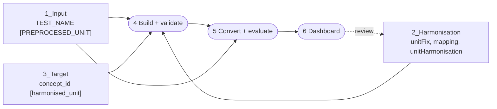

# Kanta lab harmonisation

# Overview

The aim is to map every `TEST_NAME [PREPROCESED_UNIT]` pair of the Kanta lab data to a
`concept_id [harmonised_unit]` of the OMOP vocabulary, and to convert its values to that unit.

The repository is split in `SCRIPTS/` (the code, one folder per step, each with a README) and
`DATA/` (the result of each step, in a folder of the same name). Every step runs as
`./SCRIPTS/<step>/run.sh <PATH_TO_DATA> --env <ENV_NAME>`.

## 1_Input

The source values to map: one row per `TEST_NAME [PREPROCESED_UNIT]` pair of Kanta, with the number of
records, where the unit and the value came from, the reference ranges and the deciles of the values.

## 2_Harmonisation

Hand-edited tables, the only place where the mapping is decided:

- `unitFix.tsv` — the `PREPROCESED_UNIT` may be wrong or missing; this table gives the corrected `UNIT`
  of a `TEST_NAME [PREPROCESED_UNIT]` pair.
- `mapping.tsv` — maps each `TEST_NAME [UNIT]` to a `concept_id`, with `APPROVED` and, for a pair that is
  not mapped on purpose, an `ignore_mapping_reason`.
- `unitHarmonisation.tsv` — how a `UNIT` converts to the `harmonised_unit` (`CONVERSION`, a factor or a
  formula in `X`). A rule holds for a LOINC property (`context` = `has_property`) or for one concept
  (`context` = `concept_id`, which wins). When `UNIT` and `harmonised_unit` differ, the values are converted.

## 3_Target

`concept_id [harmonised_unit]`: every standard OMOP `Measurement` concept with its LOINC axes, its LOINC
Groups and the unit its values are harmonised to. It is built from:

- the OMOP vocabulary (concepts, LOINC axes, LOINC Groups);
- lab2clean (the SI unit of each LOINC code, the LOINC Group it assigns, and the conventional-to-SI
  pairs; a conventional concept with an SI partner is removed);
- our rules: a panel and a `Presence or Threshold` (qualitative) concept have no unit;
- `harmonisedUnitOverwrite.tsv`, to change a unit that is wrong, missing or not wanted.

## 4_BuildHarmonisationTable, 5_EvaluateHarmonisedData, 6_BuildDashboard

- `4_BuildHarmonisationTable` validates the `2_Harmonisation` tables against the target and joins them
  into one table, one row per `TEST_NAME [PREPROCESED_UNIT]`, with a `mapping_status` (`APPROVED`,
  `NOT-APPROVED`, `ERROR`, `IGNORE`) and the warnings of each pair.
- `5_EvaluateHarmonisedData` applies the conversion to the Kanta deciles and compares each pair with the
  other pairs of its LOINC Group (or concept) in the same unit (Kolmogorov-Smirnov, ratio of medians).
- `6_BuildDashboard` shows the result as an HTML page to review the pairs.



# Process

`TEST_NAME [PREPROCESED_UNIT]` has to find its pair in `concept_id [harmonised_unit]`:

```
TEST_NAME [PREPROCESED_UNIT] --unitFix--> TEST_NAME [UNIT] --mapping--> concept_id [harmonised_unit]
                                                   UNIT --unitHarmonisation--> harmonised_unit
```

and the converted values have to agree with the values of the other pairs of the same concept and Group.

If they do not, the cause is one of these, and each has its fix:

| Symptom | Cause | Fix in |
|---|---|---|
| `UNIT` is empty, or the values look like another unit | the `PREPROCESED_UNIT` is wrong or missing | `unitFix.tsv` |
| `UNIT` and `harmonised_unit` cannot be converted (other property or dimension) | the mapping is wrong: the test is not that concept | `mapping.tsv` |
| `UNIT` and `harmonised_unit` can be converted, but no rule does it, or the values are off by a factor | the conversion is missing or wrong | `unitHarmonisation.tsv` |
| The values agree with no pair, or the unit is not what the labs report | the `harmonised_unit` of the concept is wrong | `harmonisedUnitOverwrite.tsv` |
| Units convert, but the values still disagree (e.g. other specimen) | the mapping is to a wrong but compatible concept | `mapping.tsv` |
| The pair is `NOT-FOUND` | the pair is not in `mapping.tsv` yet | `mapping.tsv` |

Some pairs cannot be judged by their values:

- a qualitative concept (`Presence or Threshold`) or a panel has no unit and no distribution to compare;
- a pair alone in its Group and concept has no reference;
- a LOINC Group can hold concepts that are not the same quantity (e.g. `/[HPF]` with `10*6/L`); only the
  Groups lab2clean assigns are known to share one unit, so a disagreement with a `LOINC` Group is a hint,
  not proof.
