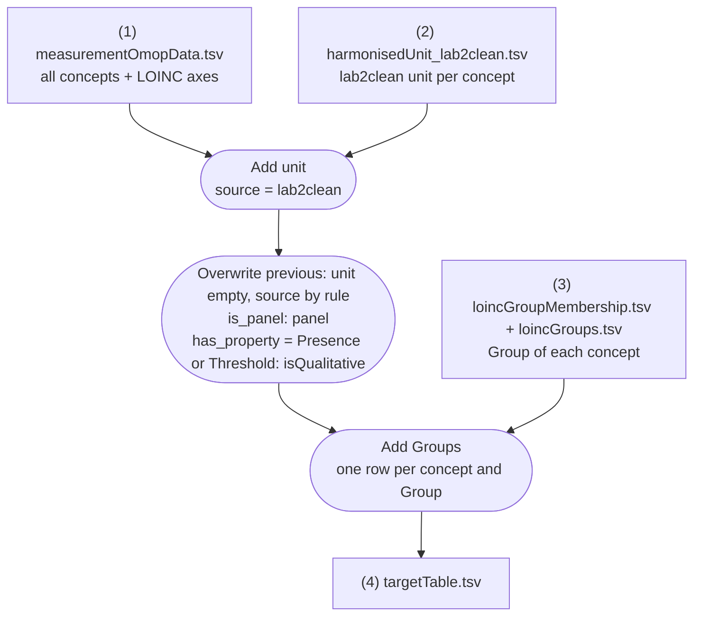

# 4_BuildTargetTable

Builds the target table: every standard `Measurement` concept with its LOINC
axes, its LOINC Group and its harmonised unit.

## Inputs

From `DATA/3_Target/`:

- `1_GetMeasurementOmopData/measurementOmopData.tsv` — the concepts and axes.
- `3_GetLoincGroupsData/loincGroups.tsv` — the Groups.
- `3_GetLoincGroupsData/loincGroupMembership.tsv` — which concept is in which Group.
- `2_GetHarmonisedUnitFromLab2Clean/harmonisedUnit_lab2clean.tsv` — the lab2clean unit of each concept.
- `2_GetHarmonisedUnitFromLab2Clean/harmonisedGroup_lab2clean.tsv` — the Group lab2clean gives to a concept.

## Outputs

In `DATA/3_Target/4_BuildTargetTable/`:

- `targetTable.tsv` — one row per concept and Group it belongs to:
  `concept_id`, `concept_code`, `concept_name`, `vocabulary_id`, `is_panel`,
  `has_component`, `has_property`, `has_method`, `has_scale_type`, `has_system`,
  `has_time_aspect` (as in `measurementOmopData.tsv`), then `group_concept_id`,
  `group_concept_code`, `group_concept_name` (as in `loincGroups.tsv`), then
  `group_source` (`lab2clean` when lab2clean gives the concept that Group, `LOINC` for the other
  memberships), then
  `harmonised_unit` and `harmonised_unit_source` (`lab2clean` when the unit
  comes from `2`, `panel` for a panel or `isQualitative` for a concept of a
  qualitative property, whose `harmonised_unit` is empty; empty for a concept with no unit). A concept in several Groups has several rows; a concept in
  no Group has one row with the `group_*` columns empty.
- `targetTable.summary.md` — a markdown report on the table: the concepts at each step (original,
  panel, isQualitative, lab2clean unit, no unit) and the Groups (number, concepts in none, by source).
- `targetTable.validation.md` — the validation of the inputs and of the table: a summary per table and one
  row per test, then the Groups with more than one `harmonised_unit`.
- `log.txt` — run log.

## Action

The table is built from the concept list of `1_GetMeasurementOmopData`, to which
the unit and the Group are added:

1. **Concepts.** Every concept of `measurementOmopData.tsv` is a row. A *conventional*
   concept (the mass side of a mass-molar pair, e.g. IgA in `mg/L`) and its SI partner
   (`umol/L`) are both kept: the mapping decides which one a test goes to.
2. **Unit from lab2clean (`2`).** The unit of each concept is its
   lab2clean unit, `harmonised_unit_source` = `lab2clean`. A concept lab2clean has no
   unit for gets none.
3. **Panels and qualitative concepts.** A panel (`is_panel`) and a concept whose
   `has_property` is `Presence or Threshold` have no unit: `harmonised_unit` is emptied,
   overwriting the lab2clean unit, and the source is `panel` or `isQualitative`
   (`panel` first).
4. **Groups (`3`).** The concept is left-joined to `loincGroupMembership.tsv` and
   then to `loincGroups.tsv`, adding the `group_*` columns. `group_source` is `lab2clean`
   when the (concept, Group) pair is the Group lab2clean gives the concept, else `LOINC`. A concept in several
   Groups gets one row per Group; a concept in no Group (for instance a panel)
   keeps one row with the `group_*` columns empty.

The table is built only from the source data (OMOP, lab2clean) and is not edited by hand: it is the
fixed target. A target unit that is missing or wrong is set by hand in
`2_Harmonisation/harmonisedUnitOverwrite.tsv`, applied by `4_BuildHarmonisationTable`.

The rows are sorted by `concept_id` and Group code. The log gives the number of
panels, qualitative concepts, concepts in a Group and concepts with a harmonised unit.

`scripts/validateTargetTable.R` validates the inputs and the table and writes `targetTable.validation.md`.
A failing test is an ERROR, or a WARNING when it does not break the table; the step stops on an ERROR, so
the steps after it do not run on a broken target:

| Table | Tests |
|---|---|
| `measurementOmopData.tsv` | the columns are there; `concept_id`, `concept_code`, `concept_name`, `vocabulary_id` have a value; `concept_id` is unique; `is_panel` is `TRUE` or `FALSE` |
| `harmonisedUnit_lab2clean.tsv` | `concept_id` and `harmonised_unit` have a value; `concept_id` is unique and in `measurementOmopData.tsv` |
| `harmonisedGroup_lab2clean.tsv` | `concept_id` and `group_concept_code` have a value; `concept_id` is unique (one Group per concept) and in `measurementOmopData.tsv`; every concept + Group is a membership of `loincGroupMembership.tsv` |
| `loincGroups.tsv` | the three columns have a value; `group_concept_id` and `group_concept_code` are unique; every Group has a member |
| `loincGroupMembership.tsv` | `concept_id` + `group_concept_id` have a value and are unique; the Group is in `loincGroups.tsv`; the concept is in `measurementOmopData.tsv`; a panel is in no Group |
| `targetTable.tsv` | `concept_id` + `group_concept_id` are unique; all concepts of a `lab2clean` Group have the same `harmonised_unit`; WARNING if `concept_id` is not unique (a concept in several Groups); WARNING if the concepts of a Group, from either source, have different units |

`scripts/summariseTargetTable.R` reads the table back and writes `targetTable.summary.md`.

