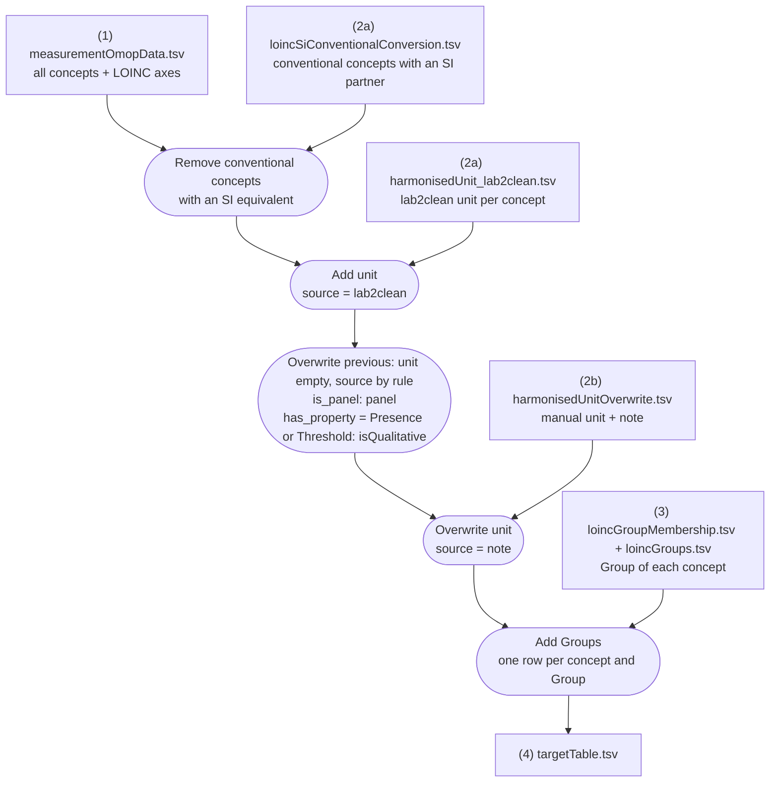

# 4_BuildTargetTable

Builds the target table: every standard `Measurement` concept with its LOINC
axes, its LOINC Group and its harmonised unit.

## Inputs

From `DATA/3_Target/`:

- `1_GetMeasurementOmopData/measurementOmopData.tsv` — the concepts and axes.
- `3_GetLoincGroupsData/loincGroups.tsv` — the Groups.
- `3_GetLoincGroupsData/loincGroupMembership.tsv` — which concept is in which Group.
- `2a_GetHarmonisedUnitFromLab2Clean/harmonisedUnit_lab2clean.tsv` — the lab2clean unit of each concept.
- `2a_GetHarmonisedUnitFromLab2Clean/harmonisedGroup_lab2clean.tsv` — the Group lab2clean gives to a concept.
- `2b_HarmonisedUnitOverwrite/harmonisedUnitOverwrite.tsv` — the units that overwrite lab2clean's.
- `2a_GetHarmonisedUnitFromLab2Clean/loincSiConventionalConversion.tsv` — the conventional concepts that have an SI partner.

## Outputs

In `DATA/3_Target/4_BuildTargetTable/`:

- `targetTable.tsv` — one row per concept and Group it belongs to:
  `concept_id`, `concept_code`, `concept_name`, `vocabulary_id`, `is_panel`,
  `has_component`, `has_property`, `has_method`, `has_scale_type`, `has_system`,
  `has_time_aspect` (as in `measurementOmopData.tsv`), then `group_concept_id`,
  `group_concept_code`, `group_concept_name` (as in `loincGroups.tsv`), then
  `group_source` (`lab2clean` when lab2clean gives the concept that Group, `LOINC` for the other
  memberships), then
  `harmonised_unit` and `harmonised_unit_source` (`lab2clean` when the unit
  comes from `2a`, the `note` of the overwrite when it comes from `2b`, `panel` for a panel or `isQualitative` for a concept of a
  qualitative property, whose `harmonised_unit` is empty; empty for a concept with no unit). A concept in several Groups has several rows; a concept in
  no Group has one row with the `group_*` columns empty.
- `targetTable.md` — a markdown report on the table: the concepts at each step (original, removed,
  panel, isQualitative, lab2clean unit, overwrite, no unit), the Groups (number, concepts
  in none) and the validations.
- `log.txt` — run log.

## Action

The table is built from the concept list of `1_GetMeasurementOmopData`, to which
the unit and the Group are added:

1. **Concepts.** Every concept of `measurementOmopData.tsv` is a row, except the
   *conventional* concepts that have an SI equivalent (the mass side of a mass-molar
   pair, listed in `loincSiConventionalConversion.tsv`), which are removed. Their SI
   partner stays.
2. **Unit from lab2clean (`2a`).** The unit of each remaining concept is its
   lab2clean unit, `harmonised_unit_source` = `lab2clean`. A concept lab2clean has no
   unit for gets none.
3. **Panels and qualitative concepts.** A panel (`is_panel`) and a concept whose
   `has_property` is `Presence or Threshold` have no unit: `harmonised_unit` is emptied,
   overwriting the lab2clean unit, and the source is `panel` or `isQualitative`
   (`panel` first).
4. **Manual overwrite (`2b`).** A concept in `harmonisedUnitOverwrite.tsv` takes
   that unit instead, even a qualitative one, and the source is the `note` of the overwrite.
5. **Groups (`3`).** The concept is left-joined to `loincGroupMembership.tsv` and
   then to `loincGroups.tsv`, adding the `group_*` columns. `group_source` is `lab2clean`
   when the (concept, Group) pair is the Group lab2clean gives the concept, else `LOINC`. A concept in several
   Groups gets one row per Group; a concept in no Group (for instance a panel)
   keeps one row with the `group_*` columns empty.

The rows are sorted by `concept_id` and Group code. The log gives the number of
panels, qualitative concepts, concepts in a Group and concepts with a harmonised unit.

`scripts/summariseTargetTable.R` reads the table back and writes `targetTable.md`, with
these validations (it stops on an ERROR):

- each `concept_id` and Group appears once (ERROR);
- `concept_id` is unique: WARNING, because a concept in several Groups has one row per Group;
- all concepts of a `lab2clean` Group have the same `harmonised_unit` (ERROR);
- all concepts of a Group, from either source, have the same `harmonised_unit` (WARNING, with the Groups that do not).

